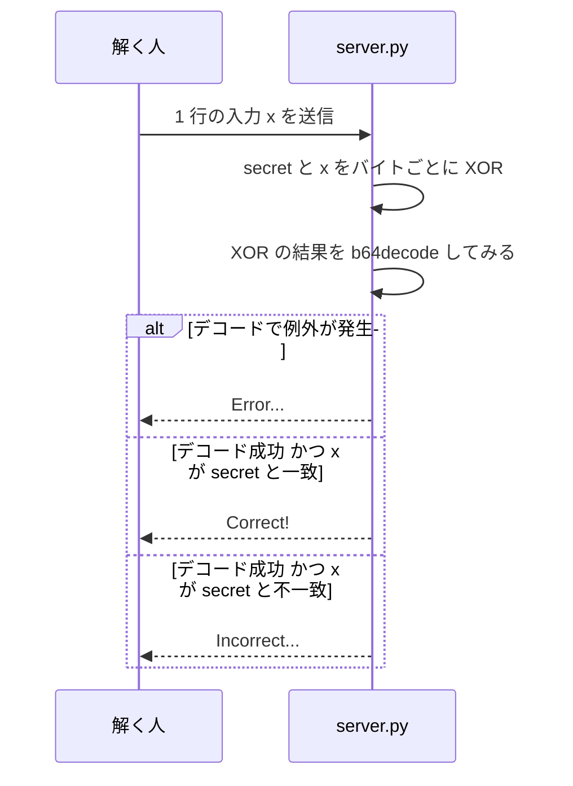
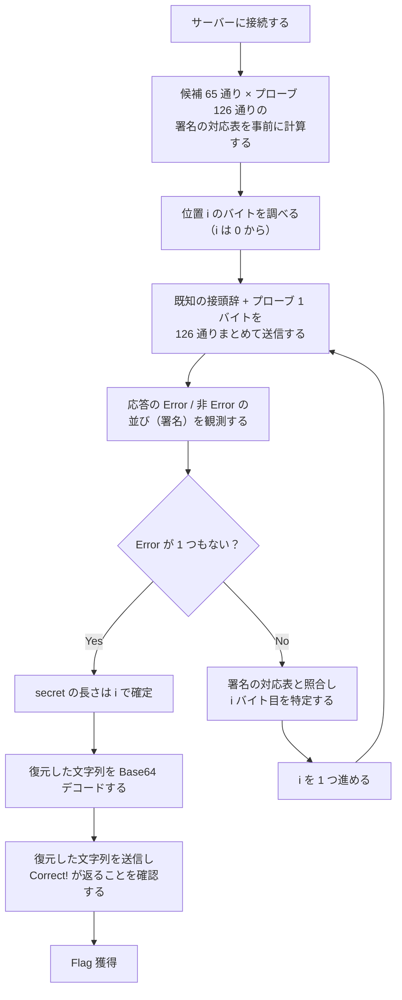

> [!IMPORTANT]
> **Solved with Codex**
>
> この問題は AI コーディングアシスタント **Codex** を活用して解決されました。

> [!NOTE]
> この Writeup は AI により自動生成されています。 本ドキュメントは、AI アシスタントを用いて作成された Writeup です。記載内容は解法の一例であり、内容の正確性については十分にご確認の上ご利用ください。

# Remnant

## 概要
*   **カテゴリー**: Misc
*   **トピック**: Encoding
*   **難易度**: Medium
*   **問題リンク**: [Remnant - Daily AlpacaHack](https://alpacahack.com/daily/challenges/remnant)

## 使用ツール
*   **Python 3**: 解法スクリプトの実装（標準ライブラリのみで動作）
*   **socket**: サーバーへの TCP 接続と送受信（Python 標準ライブラリ）
*   **base64**: 復元した文字列のデコードと検証（Python 標準ライブラリ）
*   **socat**: 問題サーバーを TCP で公開するためのツール（配布 Dockerfile で使用）
*   **Codex**: 配布ファイルの解析およびコード生成

## 問題の分析
本問題は、**Daily AlpacaHack** の Misc 問題です。問題文は次の通りです。

> I think I forgot to remove something.
> （日本語版：何か消し忘れた気がします。）

問題ページでサーバーを起動（Spawn）すると、TCP で接続できるインスタンスが払い出されます。配布ファイルは次の 3 つです。

| ファイル | 内容 |
| :--- | :--- |
| `server.py` | フラグを Base64 エンコードした文字列と入力を XOR し、デコードを試すサーバー |
| `Dockerfile` | Python 3.15.2 の環境で `socat` を使い、サーバーを TCP 1337 番ポートで公開する定義 |
| `compose.yaml` | サーバーを起動するための Docker Compose 設定 |

`server.py` の中身は次の通りです。

```python
from base64 import b64encode, b64decode

flag = b64encode(b"Alpaca{?????}")

while True:
    try:
        x = input("Input: ").encode()
        b64decode(bytes(a ^ b for a, b in zip(flag, x))) # remnant
        if x == flag:
            print("Correct!")
        else:
            print("Incorrect...")
    except:
        print("Error...")
```

ポイントは次の 3 つです。

1. サーバーが保持しているのは、フラグそのものではなく、**フラグを Base64 エンコードした文字列**です（以下、この文字列を secret と呼びます）。配布ファイル中の `?????` はプレースホルダーで、実際のフラグはサーバー側で差し替えられています。
2. 入力 `x` は secret とバイトごとに XOR され、その結果が `b64decode` に渡されます。デコードした中身は使われず、最終的な判定は入力が secret と一致するか（`x == flag`）だけです。
3. ただし、デコードで例外が起きると `except` に飛び、応答が変わります。

| サーバーの応答 | 意味 |
| :--- | :--- |
| `Correct!` | 入力が secret と完全一致した |
| `Incorrect...` | XOR 結果のデコードは成功したが、入力は secret と一致しなかった |
| `Error...` | XOR 結果のデコードで例外が発生した |

サーバーの動作を図にすると次のようになります。



## 脆弱性の詳細

### Base64 デコードの「残り」が教えてくれること
Python の `b64decode` は、デフォルトでは Base64 のデータ文字（`A`–`Z`, `a`–`z`, `0`–`9`, `+`, `/` の 64 種）でもパディングの `=` でもないバイトを**捨ててから**デコードします。一方、捨てた後に残ったデータ文字が **ちょうど 1 個** だと、長さが不正となり例外（`binascii.Error`）が発生します。

| 渡すバイト列 | `b64decode` の結果 |
| :--- | :--- |
| `A`（データ文字 1 個） | 例外（データ文字が 1 個だけ残る形は不正） |
| `=`（パディングのみ） | 成功（空のバイト列になる） |
| `!`（データ文字ではない） | 成功（無視されて空になる） |
| `\x00`（NUL バイト） | 成功（無視されて空になる） |

つまり、デコードに渡したバイト列について「データ文字が 1 個だけ残るかどうか」が、例外の有無を決めます。問題名の Remnant（残りもの）は、この「残った 1 文字」のことだと考えられます。実際、`server.py` のデコード行にも `# remnant` というコメントが付いています。

### XOR で「残り」を 1 バイトに絞る
secret を $`s`$、入力を $`x`$ と書くと、サーバーがデコードするのはバイトごとの XOR $`s \oplus x`$ です。位置 $`i`$ のバイト $`s_i`$ を調べたいとき、入力を次の形にします。

- 先頭の $`i`$ バイトには、既に判明している secret の接頭辞 $`s_0, \dots, s_{i-1}`$ をそのまま入れる
- 末尾に、試したい値（プローブ）$`p`$ を 1 バイトだけ付ける

接頭辞の部分は同じ値同士の XOR になるため、すべて 0 になります。

```math
s_j \oplus s_j = 0 \qquad (0 \le j < i)
```

0（NUL バイト）はデータ文字ではないのでデコーダに無視され、実質的に残るのは末尾の $`s_i \oplus p`$ だけです。したがって、応答は次の条件と対応します。

```math
\text{Error... が返る} \iff s_i \oplus p \in \Sigma, \qquad \Sigma = \{\text{Base64 のデータ文字 64 種}\}
```

- $`s_i \oplus p`$ がデータ文字なら、データ文字が 1 個だけ残って例外になり、`Error...` が返る
- それ以外なら、そのバイトは無視されるかパディングとして処理され、デコードが成功して `Incorrect...` が返る（入力全体が secret と一致した場合は `Correct!` になるが、これも「例外なし」の観測として扱える）

### 署名で 1 バイトを一意に特定する
プローブ 1 回分では 1 ビット（例外か否か）しか分かりません。しかし、プローブ $`p`$ を変えながら繰り返すと、候補ごとに異なる応答の並びが得られます。この並びを **署名** と呼ぶことにします。

secret の各バイトが取りうる値は、`b64encode` の出力に現れる **65 通り**（データ文字 64 種と、末尾パディングの `=`）に限られます。プローブには、0x00 から 0x7F までのうち改行（LF）と復帰（CR）を除いた **126 通り** を使います。改行は、サーバーが `input()` で 1 行ずつ読み取るため、入力の途中のバイトとしては送れません。

候補と署名の関係のイメージは次の通りです（プローブを 3 通りに絞った抜粋で、`E` は `Error...`、`-` はそれ以外を表します）。

| 候補 $`s_i`$ | $`p = \mathtt{0x00}`$ | $`p = \mathtt{0x01}`$ | $`p = \mathtt{0x41}`$（`A`） |
| :--- | :---: | :---: | :---: |
| `A`（0x41） | E | - | - |
| `B`（0x42） | E | E | - |
| `=`（0x3D） | - | - | - |

抜粋の 3 通りだけでは `=` の行は空に見えますが、126 通りすべてのプローブに対する署名を事前に計算すると、65 通りの候補すべてで署名が異なり、重複がないことが確認できます。実測した署名をこの対応表と照合すれば、その位置のバイトが一意に決まります。

なお、この方法では secret の長さを事前に仮定する必要もありません。接頭辞が secret 全体と一致した状態でプローブを付けると、`zip` が短い方（secret）の長さに合わせて切り捨てるため、XOR はすべて 0 になり、その位置ではどのプローブでも `Error...` になりません。「全プローブで例外なし」になった位置が、secret の終端です。

## 攻撃フロー


> [!TIP]
> 復元した文字列が本物かどうかは、それをそのままサーバーへ送り返して `Correct!` が返るかで確かめられます。1 回の確認でも十分ですが、確実を期すなら新しい接続でもう一度送って確認することもできます。ただし、確認のための再送信や再接続は必要最小限に留めてください。過剰に繰り返すと、共有のインスタンスやプラットフォーム側に無駄な負荷をかけてしまいます。

## 補足

<details>
<summary>補足: 候補に = が含まれる理由（クリックで展開）</summary>

`b64encode` の出力の末尾には、元のデータの長さに応じて `=` が 0〜2 個付きます。secret の末尾のバイトもこの例外ではないため、候補はデータ文字 64 種だけでなく `=` を含めた 65 通りになります。なお、`=` 自体はデータ文字ではないので、XOR の結果が `=` になっても例外にはなりません。この「例外にならない」ことも署名の違いの一部として効いてきます。

</details>

<details>
<summary>補足: プローブをまとめて送れる理由（クリックで展開）</summary>

サーバーは 1 つの接続の中で入力を繰り返し処理します（`while` ループ）。そのため、1 位置分の 126 行を先にまとめて送ってから、応答をまとめて読み取っても、1 行ずつ往復した場合と結果は変わりません。問い合わせの回数自体は「1 バイトあたりプローブの数 × バイト数」が目安になりますが、通信の往復をまとめられる分、制限時間のあるインスタンスでも現実的な時間で終わります。

</details>

<details>
<summary>補足: プローブに 0x80 以上の値を使わない理由（クリックで展開）</summary>

候補となるバイトは、すべて 7 ビットの ASCII 文字（データ文字と `=`）です。プローブも 7 ビットの範囲（0x00〜0x7F）に収めておけば、候補ごとの署名をすべて異なる形にできます。加えて、送信する入力全体がテキストの行として素直に扱える範囲に収まります。

</details>

> [!WARNING]
> この問題の本質は、**例外が出たかどうかという 1 ビットの情報漏れ**です。漏れるのが「デコードできたか否か」だけであっても、繰り返し問い合わせることで秘密全体を 1 バイトずつ復元できてしまいます。実システムでは、検証の成否だけでなく、例外の種類や応答の違いから内部の状態を推測されないように設計することが重要です。また、Base64 は秘匿のための仕組みではなく単なるエンコーディングであり、XOR と組み合わせても暗号の代わりにはなりません。

## 用語解説
*   **Base64**: バイナリデータを 64 種類の文字（`A`–`Z`, `a`–`z`, `0`–`9`, `+`, `/`）で表すエンコーディング方式です。暗号化ではないため、誰でもデコードできます。
*   **パディング**: Base64 で、出力の長さを 4 の倍数にそろえるために末尾へ付ける `=` のことです。元のデータの長さに応じて 0〜2 個付きます。
*   **XOR（排他的論理和）**: ビットごとの演算で、同じ値同士の XOR は 0 になる性質があります。今回はこの性質を使って、既知の部分の影響を消しています。
*   **エラーオラクル**: 入力に対する応答の違い（ここでは例外の有無）から、秘密の情報を少しずつ引き出す仕組みのことです。オラクル（oracle）は「神託」の意味です。
*   **サイドチャネル**: 計算結果そのものではなく、エラーの有無や応答時間のような副次的な情報から秘密を推測する攻撃の総称です。
*   **`zip`**: Python の組み込み関数で、複数の並びを組にして順に取り出します。長さが異なる場合は、短い方に合わせて途中で止まります。
*   **socat**: ネットワーク接続とプログラムの標準入出力をつなぐツールです。`nc` で接続する形式の問題を公開する際によく使われます。

## 解決スクリプト
[solve.py を参照してください](./solve.py)

```bash
python3 solve.py <HOST> <PORT>
```

問題ページでサーバーを起動（Spawn）すると、接続先のホストとポートが表示されます。それらを引数に指定して実行してください。追加のライブラリは不要で、Python の標準ライブラリだけで動作します。
